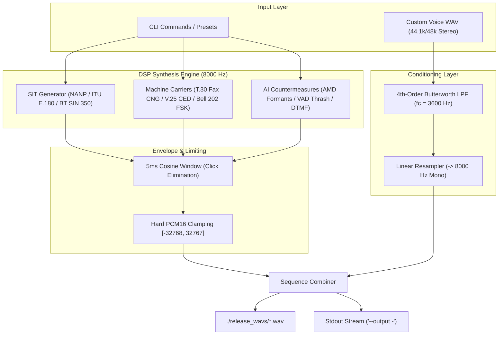

<div align="center">

# 📞 `telcotrap`

### **Telephony Trap & Anti-Robocall DSP Audio Synthesis Toolkit**

[](https://www.python.org/)
[](https://www.gnu.org/licenses/gpl-3.0)
[](https://en.wikipedia.org/wiki/G.711)
[-success.svg?style=flat-square)](https://docs.python.org/3/library/)

<p align="center">
  A public-ready, zero-dependency Python audio synthesis engine designed to disrupt <b>predictive dialers</b>, <b>Answering Machine Detection (AMD) DSPs</b>, and <b>conversational AI voice agents</b> across the world's most populous telecommunications networks.
</p>

</div>

---

## ⚡ Key Highlights

- **Zero Third-Party Dependencies**: Runs strictly on the Python standard library (`wave`, `math`, `struct`, `random`, `argparse`, `json`). Zero pip installs across Linux, macOS, and Windows.
- **Telecom Audio Invariants**: Bit-accurate output in PSTN/VoIP standard format: **8000 Hz, 16-bit Signed Little-Endian Mono PCM WAV**.
- **Click & Splatter Suppression**: Adaptive 5ms cosine window envelope ($w(i) = \frac{1}{2}(1 - \cos(\frac{\pi i}{N}))$) on all tone boundaries eliminating DSP-tripping edge clicks.
- **Telcordia GR-506-CORE Calibrated Headroom**: Single tones calibrated at -12 dBFS to prevent Automatic Gain Control (AGC) ducking and clipping in carrier AMR-WB and G.711 transcoders.
- **Echo Canceller Disabler**: 2100 Hz ITU-T V.25 answer tone with 180° phase inversions locked to nearest zero-crossings with 1ms micro-crossfades.
- **Anti-Aliasing Resampler**: Ingests user voice greetings of any sample rate (44.1kHz, 48kHz, 16kHz) and downmixes to mono with a 4th-order Butterworth low-pass filter ($f_c = 3600\text{ Hz}$).
- **Stream-Safe**: Supports direct stdout piping via manual 44-byte RIFF header assembly (`--output - | aplay`).
- **Spectral Diagnostic Inspector**: Built-in Generalized Goertzel algorithm reports dominant telecom signaling frequencies directly on headless servers.

---

## 🎯 Threat Models & Signaling Architecture



### 1. Robocall & Autodialer Database Scrubbing
Predictive dialers (Asterisk, Vicidial, FreeSWITCH, Genesys) rely on real-time DSP tone detectors during call setup. When a **Special Information Tone (SIT)** or **Fax CNG** tone is encountered, dialers immediately classify the call result as `SIT_INTERCEPT`, `VACANT_NUMBER`, or `FAX_DETECT`. This triggers automatic database scrubbing, removing your number from outbound campaigns.

### 2. Conversational AI Voice Bot Tarpitting
Modern AI voice agents (OpenAI Realtime API, LiveKit, Cartesia, Deepgram) employ Voice Activity Detection (VAD) with barge-in interruption. telcotrap's `vad_thrash` module generates jittered pink noise bursts (-22 dBFS) that continuously cross the AI's speech-energy threshold, forcing the bot to perpetually cancel its text-to-speech output, reset its inference context, and lock up in an endless loop.

---

## 🌍 Regional Presets (`./release_wavs/`)

| Preset File | Target Region | Telecom Standards & Modules | Primary Effect |
| :--- | :--- | :--- | :--- |
| **`US_Canada_Max_Disrupt.wav`** | 🇺🇸 United States<br>🇨🇦 Canada | Bellcore Intercept SIT (`913.8 / 1370.6 / 1776.7 Hz`) + Fax CNG (`1100 Hz`) + AMD Formant Spoof | Maximum all-around robocall scrubbing and dialer disconnect. |
| **`US_Canada_Vacant_Drop.wav`** | 🇺🇸 United States<br>🇨🇦 Canada | Bellcore Vacant Code SIT (`985.2 / 1428.5 / 1776.7 Hz`) + Fax CNG (`1100 Hz`) | Aggressive number removal for lines with heavy spam. |
| **`EU_India_Brazil_Disconnect.wav`** | 🇪🇺 European Union<br>🇮🇳 India<br>🇧🇷 Brazil / LatAm | ITU-T E.180 SIT (`950 / 1400 / 1800 Hz`) + ETSI Congestion (`425 Hz`) + Fax CNG | Standard global GSM disconnect signal recognized worldwide. |
| **`UK_Disconnect_Fax.wav`** | 🇬🇧 United Kingdom | BT SIN 350 SIT (`950 / 1400 / 1800 Hz`) + BT Number Unobtainable (`400 Hz`) + Fax CNG | Tailored for BT, EE, O2, and Vodafone UK exchanges. |
| **`APAC_Japan_Disconnect.wav`** | 🇯🇵 Japan<br>🌏 Asia-Pacific | NTT Howler/Busy tone (`400 Hz`) + ITU-T E.180 SIT + Fax CNG | Engineered for Japan NTT and regional Asia-Pacific networks. |
| **`AI_Agent_VAD_Tarpit.wav`** | 🌐 Global (AI Defense) | AMD Voiced Formants (`120Hz + harmonics`) + VAD Pink Thrash + DTMF Sequence (`9,*,#,0,2`) + Comfort Noise | Disrupts LLM speech agents, conversational bots, and IVRs. |

---

## 📱 Carrier Voicemail Direct Dial-In Directory

To set a trap preset as your voicemail greeting, dial your carrier's direct access code:

| Carrier | Dial-In | Navigation Sequence |
| :--- | :--- | :--- |
| **Verizon Wireless** | `*86` | PIN $\to$ `[4]` Personal Options $\to$ `[3]` Greetings $\to$ `[1]` Record Personal Greeting |
| **AT&T Mobility** | Hold `1` | PIN $\to$ `[4]` Personal Options $\to$ `[3]` Greetings $\to$ `[2]` Record New Greeting |
| **T-Mobile US** | `123` | PIN $\to$ `[*]` $\to$ `[4]` Personal Options $\to$ `[3]` Greetings $\to$ `[1]` Record |
| **Rogers Wireless** | Hold `1` | PIN $\to$ `[4]` Personal Options $\to$ `[3]` Greetings $\to$ `[1]` Record |
| **Bell Mobility** | `*98` | PIN $\to$ `[4]` Personal Options $\to$ `[3]` Record |
| **Telus Mobility** | Hold `1` | PIN $\to$ `[4]` Options $\to$ `[1]` Change Greeting |
| **EE (UK)** | `222` | `[2]` Greetings $\to$ `[1]` Change Personal Greeting |
| **O2 (UK)** | `901` | `[*]` $\to$ `[4]` Mailbox $\to$ `[3]` Greetings $\to$ `[1]` Record |
| **Vodafone (UK)** | `121` | `[4]` Personal Settings $\to$ `[1]` Greetings |
| **Three (UK)** | `123` | `[4]` Options $\to$ `[2]` Greetings |
| **Telekom (DE)** | `3311` | `[3]` Mailbox Settings $\to$ `[1]` Greeting Menu |
| **Vodafone (DE)** | `5500` | `[2]` Options $\to$ `[1]` Greetings |
| **Orange (FR)** | `888` | `[2]` Personal Greeting $\to$ `[1]` Record |
| **Vivo (BR)** | `*555` | Saudação Personalizada $\to$ Record |
| **Claro (BR)** | `*555` | Opções da Caixa Postal $\to$ Change Greeting |
| **TIM (BR)** | `*100` | `[4]` Configurações $\to$ `[2]` Mensagem de Saudação |

> **India Note (Jio, Airtel, Vi)**: Standard carrier voicemail is rarely enabled by default. Use conditional call forwarding (`*61*<Voicemail_Number>*11*30#` for unanswered, `*67*<Voicemail_Number>#` for busy) or on-device screening.

---

## 🛠️ Audio Injection Methods

### Method 1: Hardware 3.5mm TRRS Line-In (Highest Fidelity)
```
[ PC Headphone Out ] ──► [ -20 dB Attenuation Pad ] ──► [ 3.5mm TRRS Mic Jack ] ──► [ Smartphone ]
```
> **Warning**: PC headphone outputs output $\approx 1.0\text{V}$ line level, whereas smartphone mic preamps expect $10\text{–}50\text{mV}$. Set PC volume to 8–10% or use an inline -20 dB pad to prevent severe audio clipping.

### Method 2: Softphone & Virtual Audio Loopback (PBX / VoIP)
- **Linux**: Use `pw-loopback` in PipeWire to route the WAV into a softphone (Linphone, MicroSIP).
- **Windows**: Route media player output to **VB-Audio Virtual Cable**, and set softphone microphone to the virtual cable.
- **macOS**: Route playback to **BlackHole 2ch** virtual audio driver.

### Method 3: Apple iOS 17+ Live Voicemail (On-Device)
1. Open **Phone** $\to$ **Voicemail** $\to$ **Greeting** $\to$ **Custom**.
2. Tap **Record**, play the chosen preset WAV file, and tap **Save**.
3. All incoming calls screened by iOS Live Voicemail will immediately broadcast the SIT tone and Fax CNG payload, hanging up robocallers before your phone rings.

---

## 💻 CLI Usage & Quickstart

```bash
# Clone the repository
git clone https://github.com/Necrotyk/telcotrap.git
cd telcotrap

# Build all 6 production release packs
python3 telcotrap.py --build-release-pack

# Synthesize a custom sequence (NANP Intercept + Fax CNG)
python3 telcotrap.py --sequence na_nanp_ic,fax_cng --output intercept_fax.wav

# Prepend trap to an existing voice message (with anti-aliasing resampling)
python3 telcotrap.py --sequence na_nanp_ic --mix-voice my_greeting.wav --output greeting.wav

# Inspect audio metrics and run Goertzel frequency detection
python3 telcotrap.py --inspect release_wavs/US_Canada_Max_Disrupt.wav

# Stream directly to Linux ALSA sound system (no temp files)
python3 telcotrap.py --sequence na_nanp_ic,fax_cng --output - | aplay
```

### Audio Inspector Sample Output

```
================================================================
TELCOTRAP AUDIO INSPECTOR: release_wavs/US_Canada_Max_Disrupt.wav
================================================================
Channels         : 1 (Mono)
Sample Rate      : 8000 Hz
Bit Depth        : 16-bit PCM
Frame Count      : 67056 samples
Duration         : 8.382 seconds
Peak Amplitude   : -11.00 dBFS
RMS Energy       : -19.45 dBFS
----------------------------------------------------------------
Detected Telecom & Supervisory Frequencies (Goertzel Peak Detection):
  *   913.8 Hz [NANP Intercept Low      ] :  -24.0 dBFS
  *  1100.0 Hz [T.30 Fax CNG            ] :  -17.7 dBFS
  *  1370.6 Hz [NANP SIT Mid            ] :  -22.4 dBFS
  *  1776.7 Hz [NANP SIT High           ] :  -21.5 dBFS
================================================================
```

---

## 🧪 Automated Test Suite

Run the hermetic test suite verifying DSP mathematics, filter stability, and WAV headers:

```bash
python3 -m unittest discover -s tests -v
```

---

## ⚖️ License & Ethical Notice

`telcotrap` is released under the **GPL-3.0-or-later** license strictly for lawful, defensive consumer privacy protection and telecommunications security research against unsolicited, fraudulent, or abusive robocallers. Users are responsible for compliance with local telecommunications laws and carrier terms of service.
